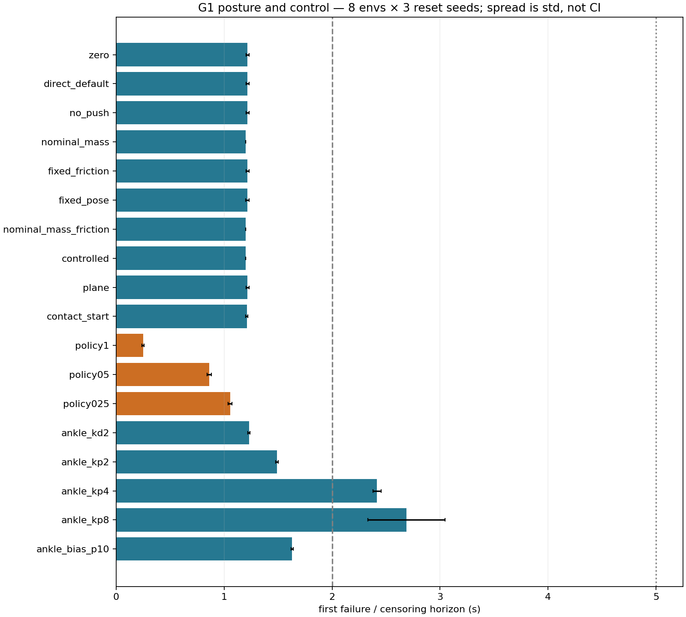
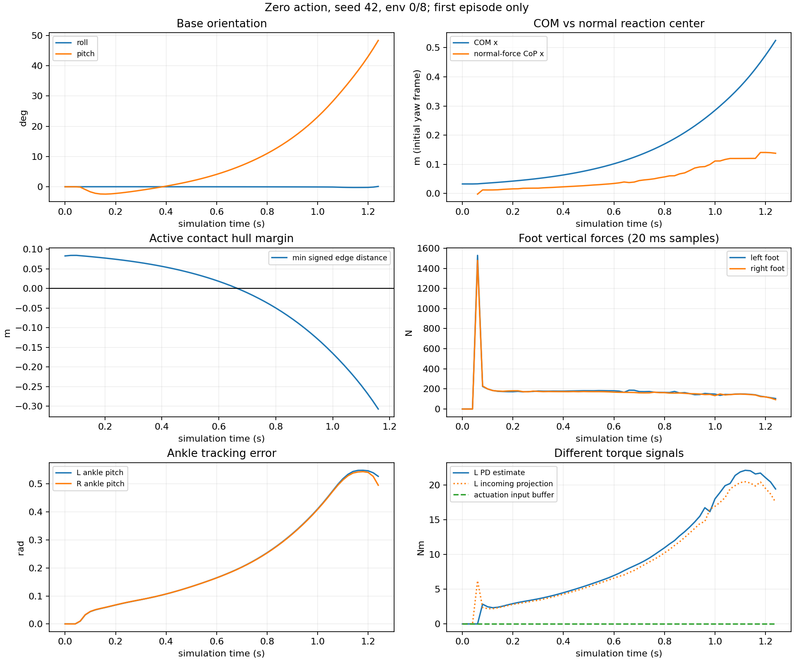
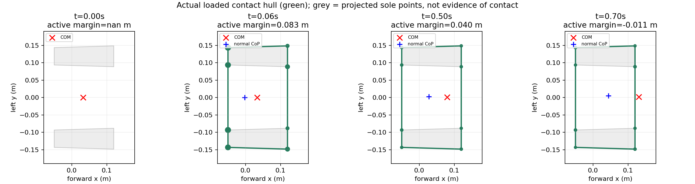
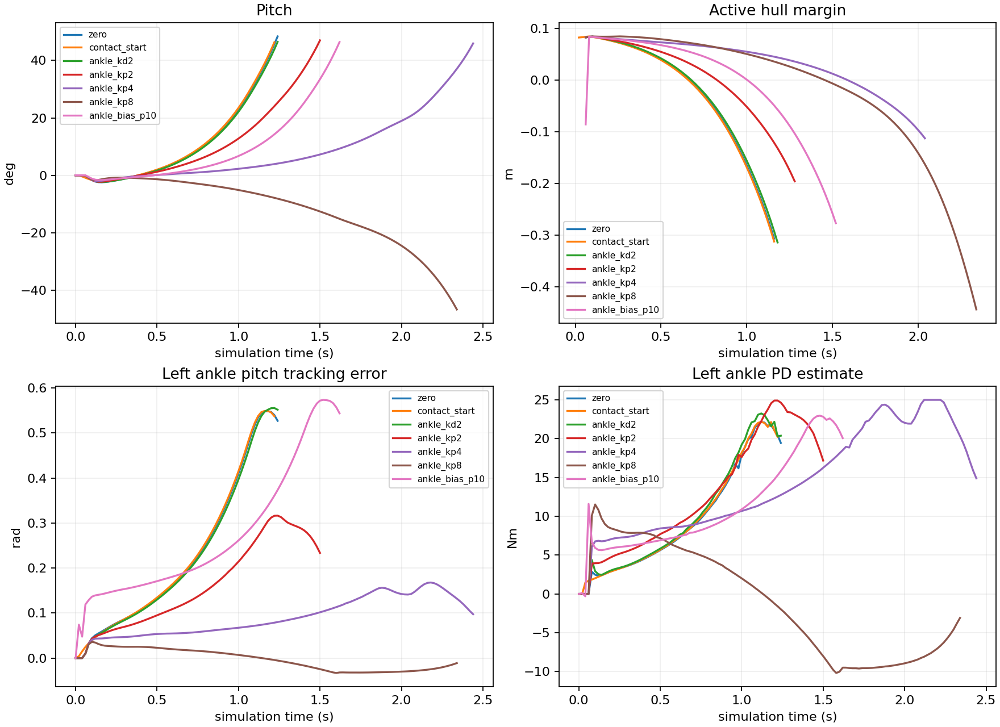

# Báo cáo cuối Mốc B — Posture, settling và PD của Unitree G1 29 DoF

Ngày tổng hợp: **20/10/2026**. Dữ liệu thí nghiệm gốc: **19/10/2026**.
Phạm vi: **STAGE 7 — phân tích offline dữ liệu đã lưu**, instance 56912565.
Trạng thái báo cáo: **PASS về tổng hợp, đối chiếu và bảo toàn dữ liệu**.
Trạng thái robot: **CHƯA ĐẠT STANDING; CHƯA ĐẠT WALKING BASELINE**.

## 1. Kết luận chính

Có đủ **18 cases ×24 first episodes =432 first episodes lịch sử** trong JSON, cùng **51 pairing records**. Mọi first episode đều kết thúc vì `bad_orientation`, không có censoring hoặc episode sống đủ 5 s. Đây không phải rollout mới trên máy khôi phục; không cộng/nhầm 432 first episodes Mốc B với số auto-reset Stage 6.

Zero-actions giữ nominal joint targets nhưng chỉ sống trung bình **1,217500 s**. Mean policy α=1 đạt **0,250000 s**; α=0,5/0,25 đạt **0,862500/1,055833 s**, vẫn kém zero. Action transport đúng và reset cache đã sửa không đồng nghĩa weights cũ đã giữ được thăng bằng.

Zero có initial free-fall/settling, sau đó COM tiến ra trước trong khi phản lực chân vẫn tồn tại; ankle pitch lệch target lớn. Tăng stiffness hai ankle pitch làm chậm mất cân bằng: Kp ×2/×4/×8 đạt **1,489167/2,415000/2,689167 s**. **Kp ×4 và ×8 không phải giải pháp standing thành công**: tất cả 24/24 episode mỗi case vẫn ngã. Kp ×8 giữ ankle tốt hơn nhưng waist/knee tiếp tục sai lệch; hình env0 cho thấy pitch ngả về sau.

Không có bằng chứng torque saturation là nguyên nhân bắt buộc của mọi lần ngã: zero/policy α=1 có **0 estimated-clipping samples**, Kp ×4 có **193**. Các torque đang có là estimates hoặc reaction projections, không phải sensor motor torque thuần.

**Giới hạn quyết định:** cả **18 thư mục raw trajectory đều thiếu**. Chỉ kiểm chứng được aggregate/per-episode JSON, CSV, hình và mã phân tích hiện có; không thể kiểm toán lại toàn bộ pipeline từ NPZ/static/manifest gốc. Một số mốc COM-outside t=0 đáng nghi, phải giữ trạng thái chưa xác minh.

## 2. Nguồn, phương pháp và mức độ kiểm chứng

Nguồn đã đọc:

- [Tiến độ Mốc B](MOC_B_PROGRESS.md).
- [Chẩn đoán điều khiển](CONTROL_DIAGNOSIS_AND_PLAN_20261019.md).
- [Reset fix và standing baseline](RESET_FIX_AND_STANDING_BASELINE_20261019.md).
- [Walking evaluation lịch sử](EVALUATION_WALKING_BASELINE_20261019.md), gồm đính chính reset.
- [Diagnostic](scripts/rsl_rl/diagnose_posture_pd.py), [summarizer](scripts/rsl_rl/summarize_posture_pd.py), [geometry helpers](scripts/rsl_rl/posture_geometry.py).
- Toàn bộ 14 artifacts analysis, inventory và SHA-256 tại Phụ lục C.

Không chạy diagnostic/summarizer: diagnostic mở simulator; summarizer cần raw NPZ thiếu và sẽ ghi lại artifacts. Stage 7 chỉ dùng Python offline, không import AppLauncher, không Isaac Sim/PhysX/PPO, không sửa source/dependency.

### 2.1 Kiểm tra thực hiện lại

| Hạng mục | Kết quả |
|---|---|
| JSON strict, không key trùng/NaN/Infinity | PASS |
| Cases duy nhất | 18 |
| Episodes/case | 24 =8 env × reset seeds 42/43/44 |
| Cặp (seed,env_id) | Đủ, duy nhất trong mỗi case |
| Pairing | 51 =17 nhánh khác zero ×3 seeds |
| Unexpected fields | Rỗng trong toàn bộ 51 records |
| CSV summary so JSON | Khớp mọi numeric field, tolerance 1e−12 |
| Mean/population SD/min/max/survival/censoring | Tính lại từ records, khớp JSON |
| Joint metrics | 522 =18×29, đủ cặp case–joint |
| Setup / body masses | 29 joints /30 rigid bodies |
| Zero env0 trace | 63 mốc 0…1,24 s, bước 0,02 s |
| Tổng joint clipping / max PD so episode JSON | Khớp từng case |
| PNG/PDF | Xem 4 PNG; CRC và decompression hợp lệ. Đọc stream/nhãn 4 PDF, header/EOF và decompression hợp lệ |
| Raw case directories | **0/18 có mặt** |

Độ rộng hàng CSV nhất quán. Không có sai lệch số học giữa summary CSV và JSON. Đây không phải phép đo physics độc lập: các aggregate có chung summarizer.

### 2.2 Thiết kế được source mô tả

Physics dt 0,005 s, control dt 0,02 s; horizon yêu cầu 5 s, có thể dừng khi mọi robot đã kết thúc first episode. Capture qua termination callback sau physics, **trước auto-reset**. Mỗi robot chỉ lấy đoạn tới terminal đầu, không nối nhiều episode.

Startup seed 42 cố định; reset seeds 42/43/44 **không phải ba training seeds độc lập**. Mass/material nuisance tạo lúc startup. Các env/reset cùng chia sẻ scene và tham số; 24 episodes/case không phải 24 mẫu IID. Không tính p-value/CI giả định độc lập. SD dùng `ddof=0`, là độ phân tán mô tả, không phải standard error hoặc CI.

Command diagnostic luôn (0,0,0), có assert source. Policy dùng mean inference, observation noise theo cấu hình lịch sử. Ngưỡng terminal lịch sử: tilt 0,8 rad ≈45,84°, root height 0,2 m; mọi records Mốc B dừng vì tilt.

Pairing so relative root pose (trừ env origin), root velocity, q/qdot, actor/critic observations, mass/inertia/material và engine gains; bỏ origins khỏi so trực tiếp. Tolerance 1e−5, allowed differences tùy ablation. Không phải mọi nhánh đều có observation hoàn toàn giống nhau.

## 3. Kết quả đủ 18 cases

Nguồn [summary.json](run/posture-pd-20261019/analysis/summary.json) và [standing_summary.csv](run/posture-pd-20261019/analysis/standing_summary.csv). Mean là first failure, giây; mọi hàng **24 episodes, censored=0, sống >5s=0/24, bad_orientation=24/24**. Code dùng duration >threshold; không có episode đúng 2 hoặc 5 s gây nhập nhằng.

| Case | Can thiệp | Mean (s) | SD (s) | Min–max (s) | Sống >2s |
| --- | --- | --- | --- | --- | --- |
| zero | Nominal targets, action=0 | 1.217500 | 0.015612 | 1.200–1.240 | 0/24 |
| direct_default | Ghi trực tiếp q_default | 1.217500 | 0.015612 | 1.200–1.240 | 0/24 |
| no_push | Bỏ tác động push; giữ RNG/timer | 1.217500 | 0.015612 | 1.200–1.240 | 0/24 |
| nominal_mass | Mass + inertia danh định | 1.200000 | 0.000000 | 1.200–1.200 | 0/24 |
| fixed_friction | μs=0,8; μd=0,6; restitution=0 | 1.217500 | 0.015612 | 1.200–1.240 | 0/24 |
| fixed_pose | Reset x=y=yaw=0 | 1.216667 | 0.014907 | 1.200–1.240 | 0/24 |
| nominal_mass_friction | Mass/inertia danh định + material cố định | 1.200000 | 0.000000 | 1.200–1.200 | 0/24 |
| controlled | Như trên + reset pose cố định | 1.200000 | 0.000000 | 1.200–1.200 | 0/24 |
| plane | Flat mesh → CollisionPlane | 1.217500 | 0.015612 | 1.200–1.240 | 0/24 |
| contact_start | Root z: collision thấp nhất ở z=1 mm | 1.210000 | 0.010000 | 1.200–1.220 | 0/24 |
| policy1 | Mean policy α=1 | 0.250000 | 0.010000 | 0.240–0.260 | 0/24 |
| policy05 | Mean policy α=0,5 | 0.862500 | 0.018540 | 0.840–0.880 | 0/24 |
| policy025 | Mean policy α=0,25 | 1.055833 | 0.017300 | 1.040–1.080 | 0/24 |
| ankle_kd2 | Ankle pitch Kd 2→4 | 1.230000 | 0.010000 | 1.220–1.240 | 0/24 |
| ankle_kp2 | Ankle pitch Kp 40→80 | 1.489167 | 0.011517 | 1.460–1.500 | 0/24 |
| ankle_kp4 | Ankle pitch Kp 40→160 | 2.415000 | 0.037528 | 2.380–2.480 | 24/24 |
| ankle_kp8 | Ankle pitch Kp 40→320 | 2.689167 | 0.356089 | 2.280–3.240 | 24/24 |
| ankle_bias_p10 | Ankle pitch target bias +0,10 rad | 1.630000 | 0.010000 | 1.620–1.640 | 0/24 |



*Hình 1. Mean và population SD, không phải CI.* [PDF](run/posture-pd-20261019/analysis/comparison.pdf).

### 3.1 Diễn giải đối chứng

`direct_default` và `zero` có cùng duration từng episode, max torque/contact và joint metrics; hỗ trợ zero đã đi tới nominal target đúng. Pairing direct_default/no_push/ba policy gains/ankle bias có mọi initial field sai khác bằng 0 trong records. Không suy ra rollout sau đó giống nhau.

`no_push`, `fixed_friction`, `plane` đều giữ mean 1,217500 s; nominal_mass/nominal_mass_friction/controlled còn 1,200000 s. Random mass/material, reset pose hay flat-terrain representation **không phải điều kiện cần** để zero ngã trong đối chứng này. Chưa loại ảnh hưởng interactions/generalization trên controller hoặc terrain khác.

`fixed_pose` đạt 1,216667 s. `contact_start` đạt 1,210000 s, giảm 0,007500 s (−0,62%) dù giảm sampled impact. **Chỉnh riêng khoảng rơi ban đầu không đủ khắc phục ngã.** Đây chỉ là root-z adjustment theo collision minimum về 1 mm, không phải protocol settle dưới tải tới cân bằng.

`controlled` là chuỗi nhiều yếu tố nominal_mass → nominal_mass_friction → controlled, không quy effect riêng cho một yếu tố. `plane` match nuisance physical parameters/root pose nhưng obs_policy khác tối đa 0,143439 do đường tái tạo observation được phép; với zero action, khác input không tạo feedback action.

### 3.2 Pairing chi tiết

Mỗi case dưới có đúng 3 records. Khác biệt >1e−5 chỉ thuộc field được phép:

| Case | Parent | Khác biệt đáng chú ý | Unexpected |
| --- | --- | --- | --- |
| direct_default | zero | Không | 0 |
| no_push | zero | Không | 0 |
| nominal_mass | zero | mass 2,711155 kg; inertia 0,042190 | 0 |
| fixed_friction | zero | material 0,488658 | 0 |
| fixed_pose | zero | root_pose 0,999787 | 0 |
| nominal_mass_friction | nominal_mass | material 0,488658 | 0 |
| controlled | nominal_mass_friction | root_pose 0,999787 | 0 |
| plane | zero | obs_policy 0,143439 | 0 |
| contact_start | zero | root z 0,014798 m; obs_policy 0,143852 | 0 |
| policy1 | zero | Không | 0 |
| policy05 | zero | Không | 0 |
| policy025 | zero | Không | 0 |
| ankle_kd2 | zero | engine_kd +2 | 0 |
| ankle_kp2 | zero | engine_kp +40 | 0 |
| ankle_kp4 | zero | engine_kp +120 | 0 |
| ankle_kp8 | zero | engine_kp +280 | 0 |
| ankle_bias_p10 | zero | Không ở initial | 0 |

Inertia vật lý có đơn vị kg·m². Max-component root_pose trộn vị trí/quaternion: không diễn giải 0,999787 thành mét/radian. Material cũng là vector nhiều thuộc tính; không gọi max difference là một friction coefficient duy nhất. Không có initial NPZ để kiểm lại từng tensor/chiều root; source có assertion contact_start chỉ đổi z nhưng aggregate chỉ còn max theo field.

## 4. Posture, mapping và tải trọng

[joint_setup.csv](run/posture-pd-20261019/analysis/joint_setup.csv): đủ 29 actor indices 0…28, default=offset mọi joint, scale=0,25, mọi default trong hard bounds lưu. Hai chân đối xứng: hip pitch −0,1; knee +0,3; ankle pitch −0,2 rad; hip roll/yaw và ankle roll 0. Tay: shoulder pitch +0,3 hai bên, shoulder roll ±0,25, elbow +0,97, wrist roll ±0,15 rad; waist/wrist còn lại 0.

$$q_{tgt,j}=q_{default,j}+0.25\,\alpha\,\mu_j(o).$$

q: rad; action/α: không thứ nguyên; 0,25: rad/action. Zero cho q_tgt=q_default; direct_default ghi target đó trực tiếp. Bias case đặt ankle-pitch action=0,4, nên target −0,2+0,25×0,4=**−0,1 rad**. Không sửa default production.

Source assert 29 DoF/actions, cùng joint ordering, default offset và target formula; báo cáo lịch sử có live one-hot/native target error=0. Stage 7 kiểm CSV/source, **không chạy lại live probes**; không gọi đây là đo mapping mới.

[body_masses.csv](run/posture-pd-20261019/analysis/body_masses.csv): 30 bodies, nominal total **33,341142 kg**. Chỉ torso_link khác nominal: nominal 7,816999 kg, actual **7,393964…10,528154 kg**. Total mass từng env:

| Env | Mass (kg) |
| --- | --- |
| 0 | 35.644608 |
| 1 | 33.192292 |
| 2 | 35.257941 |
| 3 | 33.624940 |
| 4 | 35.361058 |
| 5 | 33.194046 |
| 6 | 36.052296 |
| 7 | 32.918106 |

Mass randomize lúc startup; reset seeds không tạo ba bộ mass độc lập. Env0 mass **35,644608 kg**, weight khoảng **349,674 N** với g=9,81 m/s²; total mass range **32,918106…36,052296 kg**. Nominal-mass ablation thay cả inertia, nên không gọi effect là do riêng mass.

Root height, whole-body COM height và visual envelope height khác nhau. Không suy ra robot “cao 0,78 m” hay sửa reward target từ COM. Thiếu geometry raw để kiểm envelope. Qdot reset bằng 0 là kết quả lịch sử; default velocity bằng 0 nhân range [−1,1] không tạo qdot ±1 rad/s.

## 5. Settling, COM, active support polygon và CoP

### 5.1 Định nghĩa vật lý

$$M=\sum_b m_b,\qquad \mathbf c=\frac{\sum_b m_b\mathbf c_b}{M},\qquad
\mathbf v_c=\frac{\sum_b m_b\mathbf v_b}{M}.$$

m_b: kg; c_b/c: body COM/world whole-body COM, m; v: m/s. Không dùng root position hoặc trung điểm ankles thay whole-body COM.

Hull source dùng contact points hai chân có normal force >1e−4 N và |normal_z|>0,5, chiếu XY rồi convex hull. Với đỉnh CCW p_i, edge e_i=p_(i+1)−p_i:

$$d_i=\frac{e_{i,x}(c_y-p_{i,y})-e_{i,y}(c_x-p_{i,x})}{\|\mathbf e_i\|},
\qquad m_{support}=\min_i d_i.$$

Margin: m, dương trong mọi edge half-plane, âm ngoài ít nhất một cạnh. Area dùng shoelace, m². Hull <3 đỉnh trả **area=0, margin=NaN**. Sole/collision outline xám chỉ là support tiềm năng, không thay loaded contacts.

CoP proxy:

$$\mathbf p_{CoP,xy}=\frac{\sum_{k\in C}F_{n,k}\mathbf p_{k,xy}}{\sum_{k\in C}F_{n,k}}.$$

Summarizer dùng finite points và F_n>1e−4 N, **không lọc normal_z như hull**. CoP và hull có thể dùng tập khác nhau. Trên ground ngang đây là normal-reaction center; không phải full-wrench ZMP với tangential forces/contact moments. Không có load hợp lệ → CoP NaN.

$$M\ddot{\mathbf c}=\sum_k\mathbf f_k+M\mathbf g,\qquad
\dot{\mathbf L}_c=\sum_k(\mathbf p_k-\mathbf c)\times\mathbf f_k+\sum_k\boldsymbol\tau_k.$$

Trong phương trình trên, f_k là lực contact (N), g là gia tốc trọng trường (m/s²), L_c là động lượng góc toàn thân quanh COM (kg·m²/s), còn τ_k là contact moment (Nm). Tổng moment có đơn vị Nm. Phương trình COM giả sử không có lực ngoài nào khác ngoài gravity và contact; nếu có push phải thêm lực/moment tương ứng.

COM trong hull không đủ chứng minh cân bằng động; ngoài hull cũng không loại khả năng recovery bằng stepping/angular momentum. Không còn full momentum/wrench/slip series để chứng minh cơ chế duy nhất.

### 5.2 Zero, seed42, env0 — trace trực tiếp còn lại

COM_forward/CoP_forward ở initial-yaw frame, origin là trung điểm **initial** foot-link positions, không phải current ankle lever arm. Các com_v*_world vẫn thuộc world frame; không gọi com_vx_world là vận tốc tiến.

| t(s) | Pitch(°) | COM x(m) | CoP x(m) | Margin(m) | Area(m²) | Fz L/R(N) |
| --- | --- | --- | --- | --- | --- | --- |
| 0.00 | -0.000 | 0.032615 | NaN | NaN | 0.000000 | 0.00/0.00 |
| 0.04 | -0.000 | 0.032615 | NaN | NaN | 0.000000 | 0.00/0.00 |
| 0.06 | -0.105 | 0.033018 | -0.002232 | 0.083019 | 0.049644 | 1529.12/1478.68 |
| 0.10 | -1.679 | 0.035558 | 0.011915 | 0.084434 | 0.049646 | 199.43/200.26 |
| 0.50 | 1.882 | 0.079863 | 0.027778 | 0.040142 | 0.049646 | 182.16/173.09 |
| 0.66 | 5.779 | 0.118225 | 0.037406 | 0.001804 | 0.049648 | 187.32/165.41 |
| 0.68 | 6.406 | 0.124393 | 0.039057 | -0.004388 | 0.049647 | 186.71/164.52 |
| 0.70 | 7.069 | 0.130910 | 0.044142 | -0.010896 | 0.049645 | 173.89/161.08 |
| 1.00 | 23.101 | 0.285033 | 0.111234 | -0.165014 | 0.045400 | 148.58/133.25 |
| 1.24 | 48.381 | 0.524832 | 0.137835 | NaN | 0.000000 | 104.31/92.99 |

Không contact report trong 0…0,04 s; v_COM,z tại 0,02/0,04 là **−0,196200/−0,392400 m/s**, phù hợp rơi dưới g. Touchdown **lấy mẫu lần đầu 0,06 s**, không xác định contact time chính xác giữa samples. Fz L/R 1529,117/1478,677 N, tổng **3007,795 N ≈8,60 lần weight env0**. Đây là impact sample, không phải tải đứng liên tục hoặc impulse tích phân.

Tổng Fz 0,10 s còn 399,686 N, 0,26 s còn 344,692 N. Hỗ trợ có initial settling, không suy ra contact damping tối ưu/lỗi solver từ một peak. Báo cáo lịch sử ghi COM z 0,72553→0,70893 m ở touchdown; **CSV Mốc B không chứa COM z**, nên không tái tính độc lập số đó ở đây.

COM_forward **0,032615→0,079863→0,124393→0,524832 m** tại 0/0,5/0,68/1,24 s. Margin đổi **+0,001804 m ở 0,66 s →−0,004388 m ở 0,68 s**: bracket sampled onset, không nội suy thành exact time. CoP lúc 0,68 s chỉ 0,039057 m. Pitch 6,406° ở 0,68 lên 48,381° terminal. Horizontal COM speed sqrt(vx_world²+vy_world²) terminal **1,325664 m/s**.

Có load không đồng nghĩa balance: terminal vẫn tổng Fz **197,300 N** nhưng area=0/margin NaN. Có thể contact suy biến hoặc không đủ points qua filter; thiếu raw normals/counts để phân giải.



*Hình 2. First episode zero env0, không nối sau reset.* [PDF](run/posture-pd-20261019/analysis/zero_dynamics.pdf).



*Hình 3. Xanh: loaded hull; xám: potential sole outline. t=0 không hull dù COM trong outline tiềm năng.* [PDF](run/posture-pd-20261019/analysis/support_polygons.pdf).

### 5.3 NaN và độ tin cậy của onset statistic

CSV có **3 CoP NaN** ở 0/0,02/0,04 s; **7 margin NaN** ở ba mốc đầu cộng 1,18/1,20/1,22/1,24 s. Không fill 0, không coi NaN là stability success/failure. Hull suy biến không có nghĩa lực chân bằng 0.

JSON ghi first_com_outside_active_hull_s=0 ở **13/24 zero episodes**, chỉ ở seeds sau 42. Seed42 có 8/8 onset 0,66–0,68 s, mean **0,670000 s**; mean gộp24 chỉ **0,308333 s**. Không dùng mean gộp đó như thời gian mất support đáng tin cậy.

Source đọc raw get_contact_data ngay sau reset/forward, **trước physics bước đầu**; pairing không kiểm contact buffers. Một khả năng là raw contact thuộc state trước reset, đặc biệt khi yaw/xy mới khác cũ; cũng có thể do hình học/đo khác. **Đây là giả thuyết instrumentation, chưa xác nhận bug mới.** Thiếu raw NPZ/contact stamps nên chưa phân giải; root-cache fix Mốc A không tự bảo đảm contact-data lifecycle.

Phụ lục B giữ nguyên t=0 counts và seed42 sensitivity. Không tự sửa nguồn, loại record hoặc dùng onset này xếp hạng nguyên nhân PD.

## 6. Tracking 29 khớp và PD sensitivity

$$e_j(t)=q_{tgt,j}(t)-q_j(t),\quad
e_{RMS,j}=\sqrt{\frac1{N_j}\sum_t e_j(t)^2},\quad e_{peak,j}=\max_t|e_j(t)|.$$

Đơn vị rad. Summarizer ghép samples từ sau t=0 tới terminal đầu của 24 episodes: **RMS weighted theo sample count**, không phải mean episode RMS. Duration case khác nhau; so RMS là mô tả tới failure, không phải matched-horizon comparison. Muốn so prefix/cùng thời gian cần raw.

Zero ankle pitch L/R RMS **0,277833/0,276849**, peak **0,554427/0,551338 rad**. Waist pitch RMS **0,113183**, peak **0,188154**; knee RMS 0,0418–0,0419 rad. Ankle error lớn nhưng chưa quy mọi ngã cho duy nhất ankle vì whole-body load/state thay đổi.

Policy α1 ankle L/R RMS **0,401493/0,068032 rad**; shoulder pitch trái 0,246145, waist roll 0,206832, hip roll trái 0,186601, waist pitch 0,179091 rad. Phù hợp mean policy tạo chuyển động mất cân bằng nhiều nhóm; chưa có ablation nhóm joints để quy causal role riêng.

| Case | Kp/Kd | RMS L(rad) | RMS R(rad) | Peak L(rad) | Peak R(rad) | Survival mean so zero |
| --- | --- | --- | --- | --- | --- | --- |
| zero | 40/2 | 0.277833 | 0.276849 | 0.554427 | 0.551338 | +0.00% |
| policy1 | 40/2 | 0.401493 | 0.068032 | 0.530843 | 0.141655 | -79.47% |
| policy05 | 40/2 | 0.174590 | 0.212766 | 0.241420 | 0.568970 | -29.16% |
| policy025 | 40/2 | 0.171411 | 0.270836 | 0.377365 | 0.605849 | -13.28% |
| ankle_kd2 | 40/4 | 0.276945 | 0.275918 | 0.560538 | 0.554917 | +1.03% |
| ankle_kp2 | 80/2 | 0.182604 | 0.181389 | 0.320556 | 0.314897 | +22.31% |
| ankle_kp4 | 160/2 | 0.099044 | 0.098644 | 0.173816 | 0.171424 | +98.36% |
| ankle_kp8 | 320/2 | 0.021626 | 0.021633 | 0.036806 | 0.037282 | +120.88% |
| ankle_bias_p10 | 40/2 | 0.305671 | 0.304556 | 0.578618 | 0.574362 | +33.88% |

Kp: Nm/rad, Kd: Nm·s/rad. Chỉ hai ankle **pitch** đổi gains; ankle roll/joints khác giữ cũ. Kp×2/×4/×8 giảm ankle error, kéo dài survival nhưng không tạo standing. Kd×2 tăng duration 1,03%, không khắc phục loaded-position drift. Bias +0,10 rad tăng duration 33,88% dù target RMS error tăng; khác target/horizon nên không dùng RMS đó phủ nhận effect cục bộ survival.

Kp×8 ankle RMS khoảng 0,0216 rad nhưng waist pitch RMS **0,199898**, peak **0,410936**; knee RMS khoảng 0,0805. Hình seed42/env0 cho pitch ngả âm, khác zero/Kp×4 ngả dương. Không đủ raw để xác nhận hướng ngã cả 24 episodes. **Giữ ankle target sát vẫn chưa đủ balance toàn thân**.



*Hình 4. Seed42/env0 tới terminal đầu, horizon mỗi case khác nhau. Kp×8 chậm ngã hơn nhưng chưa ổn định.* [PDF](run/posture-pd-20261019/analysis/pd_sensitivity.pdf).

Đủ 29 joints ở Phụ lục A; 522 case–joint rows tại [joint_metrics.csv](run/posture-pd-20261019/analysis/joint_metrics.csv). Velocity limits metadata ở joint_setup, không có full qdot để kiểm actual exceedance. MOC_B_PROGRESS từng ghi hard-bound excess >0,001 rad bằng 0; Stage 7 chỉ kiểm default trong bounds, **không kiểm lại dynamic bound exceedance** khi thiếu q(t).

## 7. Torque estimates, effort limits và contact

### 7.1 Phân biệt tín hiệu

[ImplicitActuator source](.deps/IsaacLab-multiskill/source/isaaclab/isaaclab/actuators/actuator_pd.py) xác nhận PhysX xử lý implicit drive, framework tính torque xấp xỉ:

$$\hat\tau_j=K_{p,j}(q_{tgt,j}-q_j)+K_{d,j}(\dot q_{tgt,j}-\dot q_j)+\tau_{ff,j},\quad
\hat\tau_{clip,j}=\mathrm{clip}(\hat\tau_j,-\tau_{lim,j},\tau_{lim,j}).$$

τ: Nm. Velocity target/feedforward=0 thì thành Kp·e−Kd·qdot. Log pd_unclipped=computed_torque, pd_torque=applied_torque estimate đã clip. Actuator/control update timing không mặc định trùng q hậu-physics tại capture. instantaneous_pd là tín hiệu tính riêng nhưng series không còn để so timing.

Incoming joint force projection gồm reaction/tải truyền qua joints; **không gọi là motor torque thuần**. DOF actuation input buffer max **0 ở mọi case** phù hợp implicit position drive; không chứng minh motor không tạo torque.

Estimated clipping đếm abs(pd_unclipped)>effort_limit+1e−4 theo **joint-control samples** tới first terminal. Không phải số lần motor saturation thật, không cover mọi physics substep. Zero count chỉ nghĩa không thấy trong estimate đã lấy mẫu.

### 7.2 Torque/contact của 18 cases

PD peak: max absolute clipped estimate mọi joints. Fz peak: max **tổng hai foot net world-z samples**; không phải một contact normal hay impulse.

| Case | PD peak(Nm) | Incoming peak(Nm) | Peak Σfoot Fz(N) | Clipped samples | Episodes clipping |
| --- | --- | --- | --- | --- | --- |
| zero | 22.536 | 22.804 | 3193.165 | 0 | 0/24 |
| direct_default | 22.536 | 22.804 | 3193.165 | 0 | 0/24 |
| no_push | 22.536 | 22.804 | 3193.165 | 0 | 0/24 |
| nominal_mass | 21.430 | 21.178 | 3119.942 | 0 | 0/24 |
| fixed_friction | 22.347 | 22.646 | 3217.031 | 0 | 0/24 |
| fixed_pose | 22.385 | 22.891 | 3277.912 | 0 | 0/24 |
| nominal_mass_friction | 21.354 | 21.127 | 3066.871 | 0 | 0/24 |
| controlled | 21.369 | 21.157 | 3092.421 | 0 | 0/24 |
| plane | 22.371 | 20.711 | 600.295 | 0 | 0/24 |
| contact_start | 22.413 | 20.740 | 495.432 | 0 | 0/24 |
| policy1 | 37.356 | 45.634 | 529.848 | 0 | 0/24 |
| policy05 | 25.516 | 28.169 | 930.183 | 9 | 9/24 |
| policy025 | 24.771 | 22.624 | 814.970 | 0 | 0/24 |
| ankle_kd2 | 23.465 | 22.473 | 3247.521 | 0 | 0/24 |
| ankle_kp2 | 25.000 | 23.407 | 3239.189 | 4 | 2/24 |
| ankle_kp4 | 25.000 | 24.966 | 3275.490 | 193 | 23/24 |
| ankle_kp8 | 20.887 | 22.720 | 3272.062 | 0 | 0/24 |
| ankle_bias_p10 | 23.201 | 21.476 | 496.033 | 0 | 0/24 |

Clipping chỉ ở policy05/right_ankle_pitch **9 samples**; Kp×2/left_ankle_pitch **4**; Kp×4/left và right ankle pitch **92/101**. Tổng **206 joint-control samples**, không phải 206 independent events. Kp×4 có 23/24 episodes chứa clipping. Ankle limit **25 Nm** không đổi; wrist pitch/yaw 5 Nm, hip/knee cao hơn.

Zero max PD 22,536495 Nm tại ankle phải ≈**90,15% limit của joint đó**. Policy1 peak toàn robot 37,355598 Nm không có nghĩa vượt ankle25 Nm: peak có thể ở joint limit cao. Kiểm theo từng joint, max ratio policy1 chỉ 79,31%, clipping 0. Kp×8 max ratio khoảng 67,94%, vẫn fail.

Không đủ cơ sở nói mọi motor hết torque gây ngã. Kp×4 có clipping estimate, nhưng Kp×8 không có vẫn fail và chuyển error sang waist/knee. Cần telemetry đồng bộ substep/full wrench để kết luận saturation thật.

Zero peak Fz 3193,165 N so contact_start 495,432 N (giảm khoảng 84,49%) và plane 600,295 N; duration vẫn gần 1,21–1,22 s. Sampled impact lớn không đủ giải thích toàn bộ failure. Capture mỗi 20 ms sau physics dt 5 ms; thiếu raw impulses/substeps để tính continuous peak, energy/load integral. Terrain/contact-manifold representation cũng có thể đổi sampled peaks.

## 8. Phân loại nguyên nhân

“Xác nhận” giới hạn trong records còn lại hoặc runtime evidence được nêu; không đồng nghĩa đã tái lập raw experiments.

| Vấn đề | Bằng chứng | Mức kết luận | Giới hạn |
|---|---|---|---|
| Chưa standing | 432/432 first episodes bad_orientation, 0 sống 5 s | Xác nhận aggregate; cao | Thiếu raw terminal audit |
| Mean policy cũ giảm survival | α1 0,25 s < zero 1,2175 s; initial pairing; α giảm tăng duration | Xác nhận effect protocol; cao | Không quy riêng reward/joint |
| Sai mapping/offset gây ngã | Offset=default, direct_default=zero, historical one-hot PASS | Không được bằng chứng ủng hộ | Stage 7 không live mapping probe |
| Root-cache reset lỗi/fix | Historical native/obs A/B; Stage 6 fixed PASS và negative control có lỗi | Xác nhận scope root-cache | Không chứng minh contact lifecycle/weights học lại |
| Initial free-fall/impact | Trace không có load tới 0,04 s; vz≈−gt; touchdown 0,06 s | Xác nhận một trace; cao | Không suy rộng mọi env |
| Free-fall là nguyên nhân duy nhất | contact_start giảm impact nhưng vẫn 1,21 s | Không đủ giải thích duy nhất | Chưa full settled-init test |
| Nominal pose+PD chưa whole-body balance | COM drift, ankle/waist error, gains/bias đổi failure | Cơ chế được hỗ trợ mạnh | Chưa full wrench/inverse dynamics |
| Ankle compliance đóng góp | Kp×2/×4 giảm error/tăng duration, giữ nuisance records | Ablation hỗ trợ | Không phải duy nhất; Kp×8 vẫn fail |
| Kp×4/×8 sửa xong standing | 24/24 mỗi case fail trước 5 s | Không đúng với dữ liệu | Chỉ kéo dài duration |
| Torque saturation gây mọi ngã | Zero/policy1/Kp8 clipping 0 vẫn fail | Không được hỗ trợ | Không motor-torque sensor thật |
| Mass/friction/push/flat representation là điều kiện cần | Controls không cứu zero | Không cần trong protocol này | Chưa loại interactions/generalization |
| Onset t=0 là mất balance thật | Zero 13/24, khác seed42/trace | Chưa xác minh chất lượng đo | Suspect contact lifecycle; chưa xác nhận bug |
| Reward/curriculum/PPO budget là causal factor cụ thể | Chỉ historical logs, một policy | Chưa đủ dữ liệu | Cần training A/B |
| Một bộ posture/PD tối ưu rõ ràng | Sensitivity nhưng không case sống 5 s | Chưa đủ dữ liệu | Không đổi production từ local result |

**Kết luận cơ chế được hỗ trợ:** nominal reference chưa là cân bằng toàn thân dưới tải; sau touchdown COM drift và ankle/waist lệch target không được posture servo bù đủ. Policy hiện tại tạo targets mất balance nhanh hơn. Stiffness/bias đổi thời gian/hướng mất ổn định nhưng chưa tạo phản hồi whole-body bền vững. Chưa quy toàn bộ cho “thiếu iterations”, “Kp thấp”, “random mass” hoặc một reward term.

## 9. Đối chiếu lịch sử và các khác biệt phải giữ nguyên

Báo cáo Walking trước chẩn đoán ghi completed-episode mean standing **0,2597 s**, zero **1,2197 s** trên 64 env, khi reset còn lỗi. Mốc B ở đây dùng first episodes trên 8 env ×3 reset seeds, với reset fix và paired controls. Hai phép đo có population, denominator và lifecycle khác nhau; không gộp trực tiếp.

Báo cáo reset/standing từng ghi α=0,25 trên 8 env mean **1,0550 s**, và α=0,5 có **7 right-ankle clipping samples**. Mốc B hiện có **1,055833 s và 9 samples**. Trong Mốc B, mean α=0,25 của seed42/43 đều 1,0550 s, seed44 là 1,0575 s. Khác cohort/protocol có thể đóng góp; thiếu raw cũ nên không quy giải thích duy nhất cho mọi sai khác. Báo cáo này giữ đúng số liệu của dataset Mốc B, **không sửa nguồn hoặc báo cáo cũ**.

MOC_B_PROGRESS là ghi chú lịch sử về quá trình tổng hợp và sao lưu. Hiện hai checkpoint binary có local, nhưng **agent.yaml/env.yaml gốc của run model_199 vẫn thiếu**, cùng 18 raw case directories. Không dùng YAML smoke Stage 5 thay thế hoặc tạo snapshots lịch sử.

Việc gắn policy Mốc B với model_199 dựa vào các báo cáo lịch sử và diagnostic workflow. Aggregate JSON/CSV hiện còn **không chứa checkpoint hash, manifest và config snapshots gốc**, nên Stage 7 không xác minh độc lập được chính hash/config đã dùng để sinh trajectories. Hash của binary hiện tại không tự chứng minh provenance của dữ liệu quá khứ.

[Stage 6](.deps/stage6-logs/REPORT.md) là regression mới dùng checkpoint smoke hai iterations: 432 fixed auto-resets, 0 vi phạm; negative control có 14 violating records. Nó xác nhận reset fix hoạt động trong scope đã test, không phải tái lập Mốc B trên máy mới.

## 10. Khuyến nghị Mốc C — thiết kế, chưa thực hiện

### 10.1 Thứ tự ưu tiên

1. **Bảo toàn và provenance.** Sao lưu độc lập artifacts/checkpoints; thu hồi 18 raw directories, manifests và đúng YAML model_199 nếu nguồn gốc còn tồn tại. Không fabricate. Mọi run Mốc C phải lưu YAML thật, versions, Git HEAD/diff, asset/checkpoint hashes, seeds và termination records.
2. **Xác minh contact telemetry.** So raw contact ngay sau reset/forward với sau physics bước đầu; ghi timestamp, contact points/normals/counts, invalid/degenerate/load masks và relative foot velocity. Đây là thí nghiệm instrumentation đề xuất, chưa phải production fix. Không sửa root cache chỉ từ giả thuyết contact.
3. **Đối chứng control có giới hạn, sau khi được duyệt.** So zero ở spawn hiện tại với protocol settle được định nghĩa trước bằng contact readiness, qdot và root velocity; giữ reward/PPO/PD cố định. Posture/bias hoặc Kp thử ở nhánh riêng, từng yếu tố; so prefix cùng horizon và toàn bộ joints. Không áp Kp ×4/×8 vào production từ kết quả hiện tại.
4. **PPO reference sau reset fix.** Fresh initialization, seed42; giữ production config, PD, action scale, reward và curriculum. Giới hạn đề xuất **256 env ×200 iterations**, 24 steps/env/rollout, tương đương **1.228.800 transitions**. Lưu checkpoint0/100/199 và genuine configs ở run mới; không resume model_199 đã học trên reset lỗi. Không chạy lại training lỗi để tạo control.
5. Nếu reference chưa cải thiện, mở **nhánh standing zero-command** riêng. Không gộp reward, PD, posture và std vào cùng một thay đổi. Sau standing reference mới A/B một reward term hoặc một hyperparameter. Std 0,3–0,5 hay rollout 32–48 steps chỉ là ứng viên thử, chưa là giá trị tối ưu đã chứng minh.

Nếu chỉ cấp một pilot, ưu tiên reset-corrected reference để giữ khả năng giải thích. Standing curriculum là thí nghiệm khác. Model_199 chỉ nên dùng để so exact-config khi snapshots thật được phục hồi; smoke policy hai iterations không đại diện cho model_199. Khi thiếu originals, dùng zero và các checkpoint mới trên cùng protocol đã lưu làm đối chứng chính, ghi rõ không tái lập lịch sử.

### 10.2 Protocol và gates đánh giá đề xuất

| Hạng mục | Thiết kế và tiêu chí |
|---|---|
| Pilot có giới hạn | Tối đa 200 iterations; không tự kéo dài. Log KL, LR thực, finite losses/gradients, episode length và reset audits |
| Evaluation | Ít nhất 3 eval/reset seeds ×64 env, horizon 20 s; ghi startup/randomization. Mean-policy inference; first-episode và completed-episode metrics tách riêng |
| Commands | Standing zero trước, rồi vx=0,1 m/s; yaw và OOD sau khi đạt gate tương ứng |
| Gate tiến bộ pilot | ≥50% first episodes sống 5 s; báo median/p10, survival2/5/10/20 s và so zero/new reference. Đây chưa phải standing success |
| Standing success | ≥90% first episodes sống đủ 20 s, tilt p95 <20° trên các eval seeds; không nới ngưỡng tilt 0,8 rad để tăng score |
| Slow walking | Sau standing: ≥90% sống 20 s và XY RMSE <0,10 m/s trên command định trước; báo yaw error khi có yaw command |
| Thống kê | Per-seed và pooled; seed/scene là cluster. Không coi timesteps/resets là IID; định trước hypotheses và gates |
| Control metrics | COM drift; valid/invalid support-margin fraction; CoP/load split; contact/slip; đủ 29 q/qdot/targets; action RMS/rate; torque estimates/limits/clipping. Tách settling window |
| Dừng để kiểm tra | NaN/Inf, reset observations sai, source/config ngoài ý định hoặc telemetry không giải thích được: dừng phân tích; không thay nhiều biến để ép PASS |

Root-height target phải so với root/ground/settled state, không thay bằng COM. Log raw và weighted reward terms; reward/loss không thay survival gate. Gait/clearance gating và alive/fall penalties là hypotheses cho A/B sau reference. Không khẳng định clearance ép nhấc chân hoặc một reward term gây ngã khi chưa có phép thử.

## 11. Bảo toàn và phạm vi hoàn thành

File duy nhất thêm trong repository là **MOC_B_FINAL_REPORT.md**. Scripts, stats và audit tạm ở /tmp ngoài repo. Không ghi lại 14 artifacts analysis, logs Stage 5/6 hoặc dữ liệu lịch sử. Source, reward, curriculum, PD, checkpoints, assets, dependencies và Git HEAD/branch được đối chiếu trước–sau. Không commit/push/reset/clean.

Không có PPO mới, không chạy lại 18 experiments, không mở Isaac Sim/PhysX và không tạo snapshots lịch sử. **PASS Stage 7 là hoàn thành báo cáo; không phải PASS standing/walking hoặc xác nhận raw reproduction.** Kết thúc ở Stage 7; Stage 8/Mốc C cần phê duyệt riêng.

## Phụ lục A. Đủ 29 khớp: setup và tracking zero

Kp: Nm/rad; Kd: Nm·s/rad; q/lỗi: rad; limit/PD: Nm. Index là thứ tự actor/simulator, không phải SDK. Mọi zero row có clipping=0. Hard/velocity limits đầy đủ ở joint_setup.csv; các case khác trong joint_metrics.csv.

| Index | Joint | Default | Kp/Kd | Effort limit | Zero RMS e | Zero peak e | Zero peak PD |
| --- | --- | --- | --- | --- | --- | --- | --- |
| 0 | left_hip_pitch_joint | -0.100 | 100/2 | 88 | 0.030276 | 0.048723 | 5.080 |
| 1 | right_hip_pitch_joint | -0.100 | 100/2 | 88 | 0.030194 | 0.048508 | 5.064 |
| 2 | waist_yaw_joint | 0.000 | 200/5 | 88 | 0.000137 | 0.001682 | 0.502 |
| 3 | left_hip_roll_joint | 0.000 | 100/2 | 139 | 0.001128 | 0.004153 | 0.617 |
| 4 | right_hip_roll_joint | 0.000 | 100/2 | 139 | 0.001133 | 0.004156 | 0.600 |
| 5 | waist_roll_joint | 0.000 | 40/5 | 25 | 0.001245 | 0.005094 | 0.789 |
| 6 | left_hip_yaw_joint | 0.000 | 100/2 | 88 | 0.000524 | 0.002536 | 0.848 |
| 7 | right_hip_yaw_joint | 0.000 | 100/2 | 88 | 0.000515 | 0.002191 | 0.544 |
| 8 | waist_pitch_joint | 0.000 | 40/5 | 25 | 0.113183 | 0.188154 | 7.775 |
| 9 | left_knee_joint | 0.300 | 150/4 | 139 | 0.041789 | 0.071429 | 13.299 |
| 10 | right_knee_joint | 0.300 | 150/4 | 139 | 0.041930 | 0.072136 | 13.431 |
| 11 | left_shoulder_pitch_joint | 0.300 | 40/1 | 25 | 0.015494 | 0.037023 | 1.517 |
| 12 | right_shoulder_pitch_joint | 0.300 | 40/1 | 25 | 0.015417 | 0.036503 | 1.496 |
| 13 | left_ankle_pitch_joint | -0.200 | 40/2 | 25 | 0.277833 | 0.554427 | 22.400 |
| 14 | right_ankle_pitch_joint | -0.200 | 40/2 | 25 | 0.276849 | 0.551338 | 22.536 |
| 15 | left_shoulder_roll_joint | 0.250 | 40/1 | 25 | 0.036024 | 0.064771 | 2.675 |
| 16 | right_shoulder_roll_joint | -0.250 | 40/1 | 25 | 0.036298 | 0.064690 | 2.675 |
| 17 | left_ankle_roll_joint | 0.000 | 40/2 | 25 | 0.001568 | 0.005301 | 1.807 |
| 18 | right_ankle_roll_joint | 0.000 | 40/2 | 25 | 0.001599 | 0.004696 | 1.622 |
| 19 | left_shoulder_yaw_joint | 0.000 | 40/1 | 25 | 0.006848 | 0.013763 | 0.585 |
| 20 | right_shoulder_yaw_joint | 0.000 | 40/1 | 25 | 0.006922 | 0.013741 | 0.584 |
| 21 | left_elbow_joint | 0.970 | 40/1 | 25 | 0.013881 | 0.025466 | 1.314 |
| 22 | right_elbow_joint | 0.970 | 40/1 | 25 | 0.013901 | 0.025502 | 1.318 |
| 23 | left_wrist_roll_joint | 0.150 | 40/1 | 25 | 0.000032 | 0.000127 | 0.005 |
| 24 | right_wrist_roll_joint | -0.150 | 40/1 | 25 | 0.000032 | 0.000128 | 0.005 |
| 25 | left_wrist_pitch_joint | 0.000 | 40/1 | 5 | 0.003118 | 0.007508 | 0.387 |
| 26 | right_wrist_pitch_joint | 0.000 | 40/1 | 5 | 0.003112 | 0.007519 | 0.388 |
| 27 | left_wrist_yaw_joint | 0.000 | 40/1 | 5 | 0.001246 | 0.002684 | 0.114 |
| 28 | right_wrist_yaw_joint | 0.000 | 40/1 | 5 | 0.001259 | 0.002681 | 0.114 |

## Phụ lục B. Onset records và raw paths thiếu

Mean onset tính từ field đã lưu, **không dùng để xếp hạng cơ chế** vì t=0 chưa xác minh. Phân tích nhạy cảm seed42 không thay hoặc sửa aggregate gốc.

| Case | Onset t=0 /24 | Mean24(s) | Seed42 mean8(s) |
| --- | --- | --- | --- |
| zero | 13 | 0.308333 | 0.670000 |
| direct_default | 13 | 0.308333 | 0.670000 |
| no_push | 13 | 0.308333 | 0.670000 |
| nominal_mass | 16 | 0.220000 | 0.660000 |
| fixed_friction | 12 | 0.336667 | 0.670000 |
| fixed_pose | 0 | 0.670000 | 0.670000 |
| nominal_mass_friction | 16 | 0.220000 | 0.660000 |
| controlled | 0 | 0.660000 | 0.660000 |
| plane | 0 | 0.670000 | 0.670000 |
| contact_start | 16 | 0.221667 | 0.665000 |
| policy1 | 6 | 0.138333 | 0.172500 |
| policy05 | 15 | 0.170833 | 0.460000 |
| policy025 | 14 | 0.025000 | 0.060000 |
| ankle_kd2 | 8 | 0.453333 | 0.680000 |
| ankle_kp2 | 16 | 0.276667 | 0.830000 |
| ankle_kp4 | 7 | 1.109167 | 1.542500 |
| ankle_kp8 | 16 | 0.571667 | 1.715000 |
| ankle_bias_p10 | 0 | 0.060000 | 0.060000 |

Danh sách **18/18 raw directories thiếu**, đường dẫn relative repo; không tạo link tới file không tồn tại:

```text
run/posture-pd-20261019/initial_conditions/zero
run/posture-pd-20261019/initial_conditions/direct_default
run/posture-pd-20261019/initial_conditions/nominal_mass
run/posture-pd-20261019/initial_conditions/fixed_friction
run/posture-pd-20261019/initial_conditions/fixed_pose
run/posture-pd-20261019/initial_conditions/nominal_mass_friction
run/posture-pd-20261019/initial_conditions/controlled
run/posture-pd-20261019/initial_conditions/contact_start
run/posture-pd-20261019/no_push_paired/no_push
run/posture-pd-20261019/plane_paired/plane
run/posture-pd-20261019/pd_policy/ankle_kp2
run/posture-pd-20261019/pd_policy/ankle_kd2
run/posture-pd-20261019/pd_policy/policy1
run/posture-pd-20261019/pd_policy/policy05
run/posture-pd-20261019/pd_policy/policy025
run/posture-pd-20261019/adaptive_controls/ankle_kp4
run/posture-pd-20261019/adaptive_controls/ankle_bias_p10
run/posture-pd-20261019/kp8/ankle_kp8
```

Thiếu static.json, initial_*.npz, trajectory_*.npz, diagnostic YAML và manifests/results gốc. Chưa kiểm lại contact geometry/normals từng bước, root/body poses, inertia/material từng case, runtime target formula, đầy đủ joint q/qdot/action/torque, timing instantaneous PD, slips/exposure rates hoặc tái tạo figures từ đầu.

## Phụ lục C. Inventory 14 artifacts và SHA-256

SHA-256 tính trực tiếp từ file, được bảo toàn nguyên bản. Bốn PNG đã xem; PDF được kiểm streams, nhãn và cấu trúc cơ bản, không khẳng định pixel-identical với PNG. Mọi link trỏ file có thật.

| Artifact | Bytes | SHA-256 |
| --- | --- | --- |
| [body_masses.csv](run/posture-pd-20261019/analysis/body_masses.csv) | 5853 | `b65fced6fe5f3b49a88d0f9d8302acc421643082f75109fd935e84c043b50836` |
| [comparison.pdf](run/posture-pd-20261019/analysis/comparison.pdf) | 17535 | `b7380a2fc96867980482d3e5f2002d73087420f2e7cc5913abd1a62dfc553b4a` |
| [comparison.png](run/posture-pd-20261019/analysis/comparison.png) | 98725 | `3520533e4f6ea4d7b6d5f20246ef5b777776ddb9365ee3eb791d6d695c91f768` |
| [joint_metrics.csv](run/posture-pd-20261019/analysis/joint_metrics.csv) | 67864 | `4cc7f97354675b7600a933d5d0a47df7bb1ece25714a38ae82ca3c96ab715532` |
| [joint_setup.csv](run/posture-pd-20261019/analysis/joint_setup.csv) | 3295 | `fa7d45053d28c8037af58935131513835a9951c27b9c1aba25e05f28a866d8cd` |
| [pd_sensitivity.pdf](run/posture-pd-20261019/analysis/pd_sensitivity.pdf) | 37427 | `9483dd9e62b6b5cc0e33b1a63fe7e12db7e3d46cb80659115f96e6efd40a49bb` |
| [pd_sensitivity.png](run/posture-pd-20261019/analysis/pd_sensitivity.png) | 301314 | `835eab8410fbca4324bb12f40012a9a697b8faa24e7b4b4c86042b056a5c9d1b` |
| [standing_summary.csv](run/posture-pd-20261019/analysis/standing_summary.csv) | 1255 | `4e2c3183f708004eb4ebf9a324adc2da3a69f2c066003843e144cf619ee20460` |
| [summary.json](run/posture-pd-20261019/analysis/summary.json) | 272355 | `6b34edc8f70a089d8c718679c7f61650a95dca053506b8b99c5e2d7787b2ef62` |
| [support_polygons.pdf](run/posture-pd-20261019/analysis/support_polygons.pdf) | 22731 | `d2d7e1149fcfe85bc29c451c276451b3a52c28b8b7db0058498f2919b2e21771` |
| [support_polygons.png](run/posture-pd-20261019/analysis/support_polygons.png) | 77315 | `60e16c08b536ff8dd2e604936a1a0231e0420189cfe9be132594b256f8ac3a5c` |
| [zero_dynamics.pdf](run/posture-pd-20261019/analysis/zero_dynamics.pdf) | 29675 | `b2094e9faf18803c539e94b86ab964dd7253bf7e97dc3423ead77cee5d800107` |
| [zero_dynamics.png](run/posture-pd-20261019/analysis/zero_dynamics.png) | 256324 | `486ee22f46c61a9a166a8338403a05d9cab8cc0f1d224a71d021f57537ed0829` |
| [zero_env0_timeseries.csv](run/posture-pd-20261019/analysis/zero_env0_timeseries.csv) | 13917 | `190097e43fac1a097aeffdd42a63d9a1346919f21649f32ea93bd708364e507e` |

## Phụ lục D. Quy trình tái tính và audit

Python chuẩn reject nonfinite và duplicate JSON keys; CSV kiểm độ rộng hàng và numeric fields. Tính mean, statistics.pstdev, min/max, censor và survival từ 24 records; so CSV–JSON bằng math.isclose(rel_tol=1e−12, abs_tol=1e−12). Kiểm tập (seed,env), 17×3 pairing/allowed fields; cộng clipping theo joints so per-episode và max PD cùng case. Kiểm đủ 29 indices, default/offset/scale/bounds, gains riêng hai ankle pitch và effort limits không đổi.

Trace giữ nguyên 3 CoP NaN và 7 margin NaN. Không nội suy hoặc fill 0. Bảng chỉ làm tròn để trình bày. Toàn bộ 18 cases có 0 censored/0 survival 5 s; **48/432 first episodes sống >2 s**, chỉ thuộc Kp ×4/×8.

Baseline bảo toàn gồm 173 tracked files và 62 pre-existing outputs/assets trong phạm vi kiểm, tracked content Isaac Lab/Unitree, inventory 270 packages MultiSkill và 55 packages môi trường main. HEAD fc46f39ef0214e84cb0bb484dfec0d1fef7ba161, branch g1-multiskill. SHA source/data kiểm lại sau khi ghi report; Git có sẵn 14 smoke outputs, không yêu cầu worktree trống.

Báo cáo không biến số liệu lịch sử thành phép đo mới. Ưu tiên bằng chứng đang có; chỉ rõ dữ kiện chưa tái kiểm và giả thuyết cần thử ở Mốc C.
